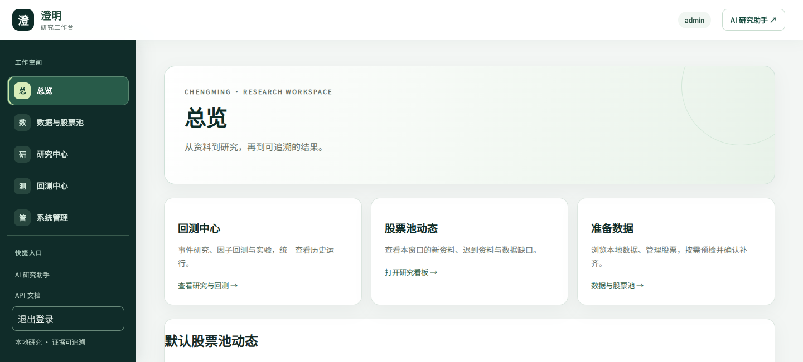
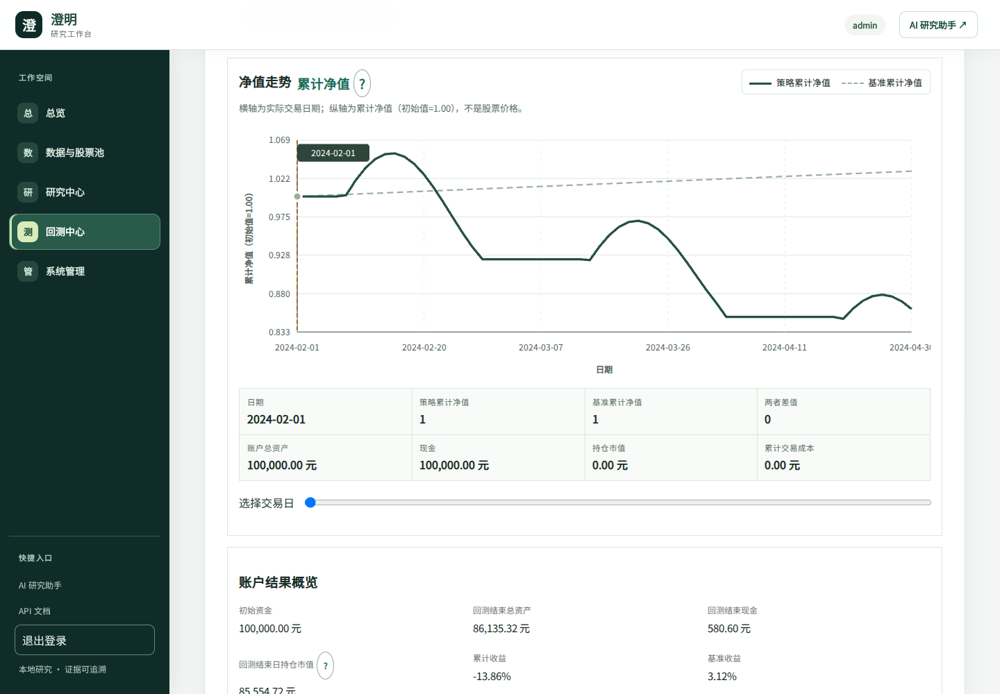

# Chengming · AI Quant Research

**A local-first workspace for A-share data, strategy experiments and auditable backtests.**

[简体中文](README.md) · [Offline example](examples/offline-demo/README.md) · [Contributing](CONTRIBUTING.md) · [Security](SECURITY.md)

[](https://github.com/buuuuuuuuu/ai-quant-research/actions/workflows/ci.yml)
[](LICENSE)

For individual researchers and developers who want to inspect local market data, combine candidate factors with daily technical signals, and reconcile simulated fills, fees, cash and positions. This is research and educational software, not a brokerage integration or a promise of investment returns. The UI and most detailed guides are currently in Chinese.

## Screenshots

Actual browser captures using synthetic local data only. No private accounts or real trade records; the numbers do not represent market performance.




## Try it locally

Python 3.12 is recommended (supported: 3.11–3.13). Install [uv](https://docs.astral.sh/uv/getting-started/installation/), then:

```bash
git clone https://github.com/buuuuuuuuu/ai-quant-research.git
cd ai-quant-research
uv sync --extra dev --frozen
uv run python examples/offline-demo/demo.py --output .demo/first --serve
```

Open <http://127.0.0.1:8080>, then Backtest Center → History. The terminal prints the daily run detail URL and HTML report path. Omit `--serve` to generate results only.

Dependency installation requires network access. **Demo generation uses deterministic synthetic data without market-provider or AI requests.** It writes only to a new output directory, refuses to overwrite an existing one, and ignores deployment environment settings. Use `.demo/second` for another run. The server binds only to loopback; stop it with `Ctrl+C`. Explicit sync/AI actions in the full UI can access external services and are outside the offline demo. See the [example guide](examples/offline-demo/README.md).

## What it does

- Local price, announcement and financial data management with source and coverage information.
- Immutable stock-pool revisions and frozen research scopes.
- Read-only readiness checks followed by explicitly confirmed download or evidence tasks.
- Point-in-time financial factors, event studies and daily technical-signal strategies.
- Separate signal, planned execution, actual attempt, fill and unfilled records.
- Interactive price/MA charts, trade tables, account audits and HTML/Excel/CSV/JSON artifacts.
- Optional AI planning and document tools; model use and external data access require their own setup.

## Limits that matter

A completed download does not imply that a dataset is ready for research. Unknown gaps remain blocking; missing values are not silently zero-filled. A static current stock pool may introduce survivorship bias. Stored local data is not necessarily an immutable snapshot of a historical run's inputs.

The specific historical suspension-evidence case for `000333` remains unverified; excluding it is a scope change, not a data repair. Synthetic calendars and prices in the demo are not real exchange history, and equal none/qfq values in the demo are not an adjustment model.

There is no live order execution, brokerage trade-history export or guaranteed-return strategy. Historical simulations only describe their recorded data and assumptions.

## Real data and deployment

Read [local data management](docs/local-stock-data-management.md) and [readiness checks](docs/research-data-readiness.md) before confirming a sync. Some legacy CLI `--source local` paths fall back to a provider when local data is missing; that flag is not an offline guarantee.

Configure authentication, session secrets, HTTPS and backups before external deployment; see [operations](docs/platform-operations.md). Do not expose the unauthenticated demo server publicly. Current database schema: **18**. Back up existing databases before upgrading.

## Development and documentation

```bash
uv run pytest
uv run ruff check .
node --test tests/js/*.test.cjs
uv build --wheel
uv run python deploy/scripts/check-wheel-contents.py
```

Node.js is needed for frontend tests. CI also validates JavaScript syntax, shell scripts and systemd units.

[Daily-signal semantics](docs/daily-signal-backtest-m12a.md) · [Account audit](docs/daily-signal-audit-m12d.md) · [Trust and scope](docs/backtest-trust-m12f.md) · [Financial factors](docs/factor-backtest.md) · [Command reference](docs/usage-reference.md) · [Architecture](docs/architecture.md)

## License

Original project code, documentation and synthetic examples are licensed under [Apache-2.0](LICENSE). Commercial use, modifications and redistribution are permitted subject to its terms. Third-party dependencies retain their own licenses. This license does not grant access or redistribution rights to market data, announcements or other external content. See [NOTICE](NOTICE) and [THIRD_PARTY_NOTICES.md](THIRD_PARTY_NOTICES.md).
